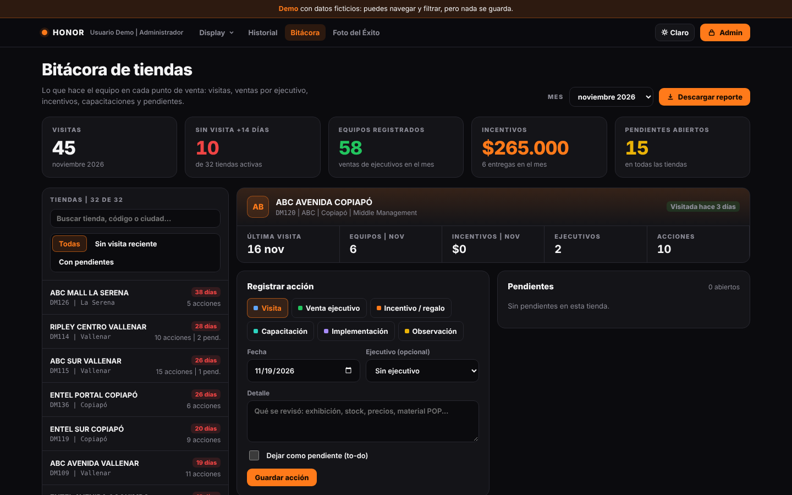
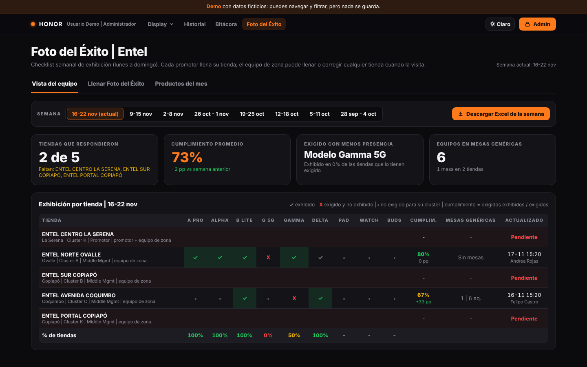
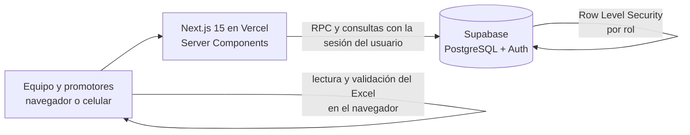

# Dashboard de Área Display | Honor Zona Norte

Aplicación web que reemplazó las planillas sueltas del equipo de merchandising de Honor en la Zona Norte de Chile.
Mide el **share de exhibición** de la marca frente a la competencia en cada tienda, guarda la **evolución en el tiempo**,
registra **lo que el equipo hace en terreno** y recibe el **checklist semanal** que llenan los promotores.

[](https://github.com/maticodder28/display-honor-demo/actions/workflows/ci.yml)


**Demo en vivo:** _pendiente de publicar_ (modo demo con datos ficticios, sin login)


> Este repositorio es la versión pública del proyecto. La versión en uso es privada; aquí todos los datos
> (tiendas, códigos, cantidades y personas) son **ficticios** y se generan con `src/lib/demo.ts`.

---

## El problema

Un equipo de tres personas (supervisor, entrenador y merchandiser) cubre cerca de 50 tiendas en cinco ciudades de
dos regiones. Cada levantamiento de exhibición quedaba en un Excel distinto, así que no había una forma rápida de
responder preguntas como:

- ¿Qué share de exhibición tiene Honor hoy, por cliente, ciudad y tipo de cobertura?
- ¿Mejoramos o empeoramos desde el último levantamiento? ¿En qué tiendas?
- ¿Cuándo fue la última visita a cada tienda? ¿Qué incentivos se entregaron y a quién?
- ¿Qué tiendas Entel tienen exhibidos los equipos que el cliente exige esta semana?

## Qué hace

| Módulo | Para qué sirve |
|---|---|
| **Display** | Share de exhibiciones, muebles (DC y Display Zone) y promotores de Honor frente a 9 marcas, con filtros por cobertura, cliente y ciudad. Puesto de Honor con empates, marca líder y detalle por tienda ordenable. |
| **Historial** | Cada Excel publicado queda como un corte con fecha. Evolución del share, comparación de dos cortes tienda por tienda (mejoró, empeoró, sin cambio) y descarga en Excel. |
| **Bitácora** | Registro de visitas, ventas por ejecutivo, incentivos con costo, capacitaciones y pendientes. Ranking mensual de ejecutivos y reporte mensual en Excel con 6 hojas. |
| **Foto del Éxito** | Checklist semanal que cada promotor llena desde el celular. Cumplimiento por cluster de tienda (K, A, B, C) y exportación en el formato que pide el cliente. |
| **Admin** | Carga del Excel de levantamiento con validación antes de publicar (hojas, marcas, códigos desconocidos, valores negativos o no numéricos). |

| Historial | Bitácora |
|---|---|
|  |  |

| Foto del Éxito | Celular |
|---|---|
|  |  |

## Arquitectura



- **Next.js 15 (App Router, React 19, TypeScript estricto).** Las páginas son Server Components que piden la sesión y
  los datos en paralelo. Los componentes interactivos (filtros, gráficos, formularios) son Client Components.
- **Supabase (PostgreSQL, Auth, RLS).** Toda la lógica de permisos vive en la base de datos, no solo en la interfaz.
- **Vercel en Sao Paulo (`gru1`)**, la misma región que la base de datos (`sa-east-1`), para que las consultas no crucen continentes.
- **Excel en el navegador:** SheetJS para leer el levantamiento y ExcelJS para generar reportes con formato, sin pasar
  archivos por el servidor.
- **Gráficos propios en SVG** (donut, líneas de evolución) con `d3-shape`, sin librerías de gráficos pesadas.

## Decisiones técnicas

- **Seguridad en Postgres, no en la página.** Cuatro roles (`admin`, `registro`, `viewer`, `promotor`) aplicados con
  Row Level Security. Un promotor solo puede leer y escribir la Foto del Éxito de su tienda, aunque llame a la API
  directamente. Solo un admin puede cambiar roles, así que nadie puede darse permisos a sí mismo.
- **Publicación atómica.** Subir un Excel llama a una sola función (`publicar_carga`) que valida el rol y la fecha y
  reemplaza el corte completo en una transacción: el dashboard nunca muestra una carga a medias.
- **Cortes como fotos completas.** Cada carga se guarda entera con su fecha de corte. Así el historial y las
  comparaciones se calculan con la misma función (`medir`) para cualquier métrica, y agregar una métrica nueva no
  obliga a cambiar las pantallas.
- **El historial no se reescribe.** Las prioridades de la Foto del Éxito se copian por semana (`foto_semanas`), y un
  producto que ya aparece en respuestas no se puede borrar, solo ocultar (trigger en la base). Cambiar la lista de
  este mes no altera los porcentajes de semanas pasadas.
- **Validación antes de publicar.** El Excel se revisa en el navegador y se muestra el share resultante antes de
  confirmar. Una fila vacía significa "sin levantamiento" y un 0 significa "la marca no tiene nada ahí": la diferencia
  importa para no bajar el share con tiendas que no se midieron.
- **Lógica de negocio separada de la interfaz.** El cálculo de share, puestos y empates (`src/lib/compute.ts`), el
  historial (`historial.ts`) y la Foto del Éxito (`foto.ts`) son funciones puras con tests.
- **Modo demo.** Con `NEXT_PUBLIC_DEMO=1` la app no usa Supabase ni login: genera datos ficticios con semilla fija y
  fechas relativas a hoy, y cualquier intento de guardar muestra un aviso. Es la versión que se publica.

## Calidad

- 26 tests con **Vitest** sobre la lógica de negocio: share, puestos con empate, Muebles como DC + Display Zone,
  comparación de cortes, semanas y cumplimiento de la Foto del Éxito, y consistencia de los datos de la demo.
- **GitHub Actions** revisa tipos, lint, tests y compilación en cada push.
- Esquema y datos de ejemplo verificados contra PostgreSQL.

## Probarlo en tu computador

Necesitas [Node.js 20 o superior](https://nodejs.org). En modo demo no hace falta ninguna cuenta:

```bash
npm install
cp .env.example .env.local      # deja NEXT_PUBLIC_DEMO=1
npm run dev
```

Abre <http://localhost:3000>. Para instalar la versión completa con Supabase, login y roles, sigue la
[guía de instalación y uso](docs/GUIA.md).

| Comando | Qué hace |
|---|---|
| `npm run dev` | Servidor local en http://localhost:3000 |
| `npm test` | Tests con Vitest |
| `npm run typecheck` | Revisión de tipos de TypeScript |
| `npm run lint` | ESLint |
| `npm run build` | Compilación de producción |
| `npm run seed:demo` | Regenera `supabase/seed.sql` con los datos ficticios de la demo |

## Estructura

```
src/
  app/                  Páginas: / (Display), /historial, /bitacora, /foto, /admin, /login
  components/           Dashboard, Historial, Bitacora, FotoExito, AdminPanel, Nav, Donut, Iconos
  lib/
    compute.ts          Share, puestos y empates por cobertura, cliente y ciudad
    historial.ts        Cortes, comparaciones y tendencias
    foto.ts             Semanas, cumplimiento y prioridades de la Foto del Éxito
    excel.ts            Lectura, validación y exportación del Excel
    reporteBitacora.ts  Reporte mensual de la Bitácora (ExcelJS)
    data.ts             Consultas a Supabase desde el servidor
    demo.ts             Datos ficticios del modo demo
    *.test.ts           Tests
supabase/
  schema.sql            Tablas, funciones, triggers y reglas de seguridad (RLS)
  migraciones/          Cambios incrementales sobre una base ya creada
  seed.sql              Datos de ejemplo ficticios
scripts/
  generar-seed.ts       Genera seed.sql desde los datos de la demo
```

## English summary

A production web app I built for Honor's merchandising team in northern Chile. It replaced scattered spreadsheets with a
dashboard that tracks the brand's in-store display share against 9 competitors across about 50 stores, keeps a full history
of every survey upload, logs the field team's store visits and incentives, and collects a weekly compliance checklist
that store promoters fill in from their phones. Stack: Next.js 15, React 19, TypeScript, Supabase (PostgreSQL with
Row Level Security), Vercel. This public repository runs in demo mode with fictional data.

## Autor

**Matías Munizaga Fuentes**, Ingeniero en Informática.
[LinkedIn](https://www.linkedin.com/in/matias-munizaga-fuentes)
