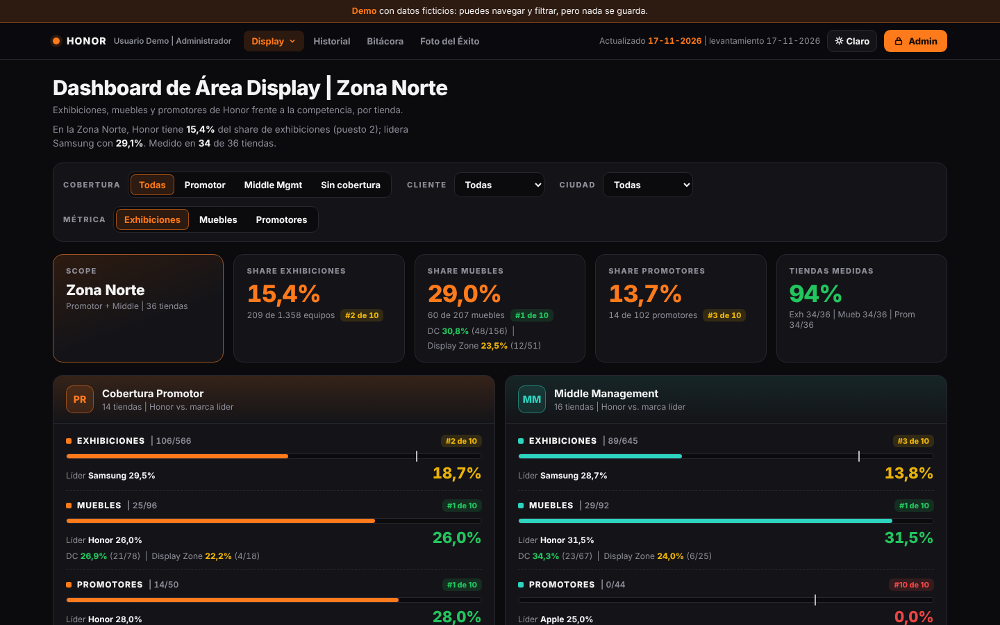
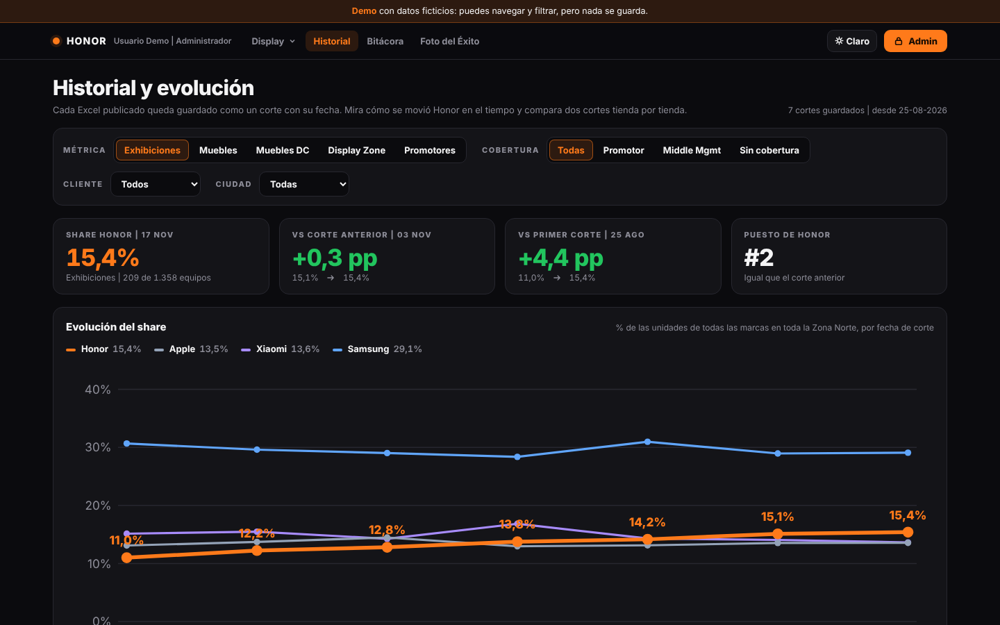
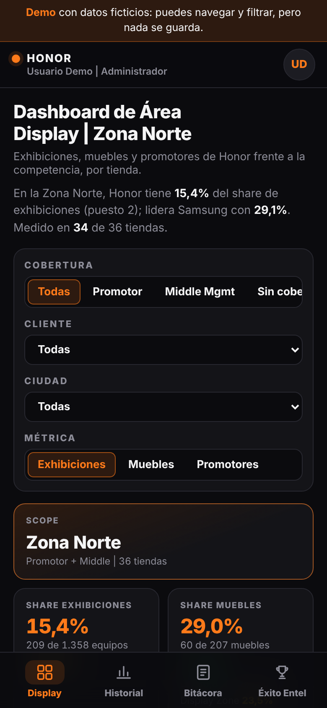
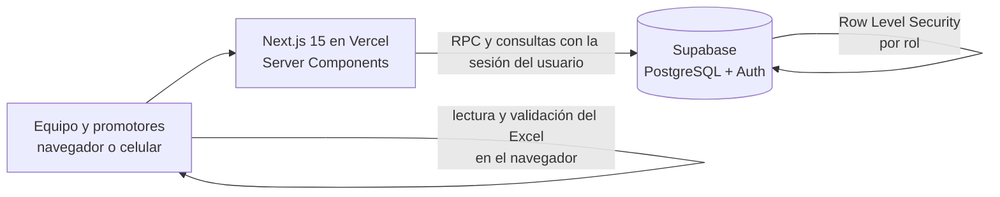

# Dashboard de Área Display | Honor Zona Norte

Aplicación web que reemplazó las planillas sueltas del equipo de merchandising de Honor en la Zona Norte de Chile.
Mide el **share de exhibición** de la marca frente a la competencia en cada tienda, guarda la **evolución en el tiempo**,
registra **lo que el equipo hace en terreno** y recibe el **checklist semanal** que llenan los promotores.

[](https://github.com/maticodder28/display-honor-demo/actions/workflows/ci.yml)


**Demo en vivo:** [display-honor-demo.vercel.app](https://display-honor-demo.vercel.app) (tiendas reales, números ficticios, sin login)



> Este repositorio es la versión pública del proyecto. La versión en uso es privada. Las tiendas son las reales de la
> Zona Norte (nombre, cadena y ciudad), pero los **números son ficticios**: share, cantidades, coberturas, códigos y
> personas se generan con `src/lib/demo.ts`.

---

## El problema

Un equipo de tres personas (supervisor, entrenador y merchandiser) cubre cerca de 50 tiendas en cinco ciudades de
dos regiones. Cada levantamiento de exhibición quedaba en un Excel distinto, así que no había una forma rápida de
responder preguntas como:

- ¿Qué share de exhibición tiene Honor hoy, por cliente, ciudad y tipo de cobertura?
- ¿Mejoramos o empeoramos desde el último levantamiento? ¿En qué tiendas?
- ¿Cuándo fue la última visita a cada tienda? ¿Qué incentivos se entregaron y a quién?
- ¿Qué tiendas Entel tienen exhibidos los equipos que el cliente exige esta semana?

## Qué hace

| Módulo | Para qué sirve |
|---|---|
| **Display** | Share de exhibiciones, muebles (DC y Display Zone) y promotores de Honor frente a 9 marcas, con filtros por cobertura, cliente y ciudad. Puesto de Honor con empates, marca líder y detalle por tienda ordenable. |
| **Historial** | Cada Excel publicado queda como un corte con fecha. Evolución del share, comparación de dos cortes tienda por tienda (mejoró, empeoró, sin cambio) y descarga en Excel. |
| **Bitácora** | Registro de visitas, ventas por ejecutivo, incentivos con costo, capacitaciones y pendientes. Ranking mensual de ejecutivos y reporte mensual en Excel con 6 hojas. |
| **Foto del Éxito** | Checklist semanal que cada promotor llena desde el celular. Cumplimiento por cluster de tienda (K, A, B, C) y exportación en el formato que pide el cliente. |
| **Admin** | Carga del Excel de levantamiento con validación antes de publicar (hojas, marcas, códigos desconocidos, valores negativos o no numéricos). |
| **Asistente** | Preguntas en lenguaje natural ("¿en qué tiendas de Ovalle está más débil Honor?") respondidas con los datos, con un motor de NLP propio que corre en el navegador. |

| Historial | Bitácora |
|---|---|
|  |  |

| Foto del Éxito | Celular |
|---|---|
|  |  |

## Asistente: NLP propio, sin servicios externos


El asistente no usa un modelo de lenguaje externo ni una API de pago. Es un pipeline propio que corre completo en el
navegador:

```
pregunta -> extractor de entidades -> clasificador de intención -> herramienta -> respuesta con tabla o gráfico
```

1. **Extractor de entidades** (`src/lib/asistente/entidades.ts`). Encuentra tienda, ciudad, cliente, marca, métrica,
   cobertura, cantidad y dirección comparando contra los valores reales de los datos, con distancia de edición para
   tolerar errores de tipeo ("ovale", "falabela"). Reemplaza cada entidad por un marcador (`_ciudad_`), así el
   clasificador aprende la forma de la pregunta y no nombres concretos.
2. **Clasificador de intención** (`clasificador.ts`). TF-IDF sobre raíces y pares de raíces, más regresión logística
   multinomial, entrenada con un script propio (descenso de gradiente con Adam y L2, sin librerías de ML). Distingue
   10 intenciones, incluida "fuera de alcance". Bajo 45 % de confianza no adivina: pide reformular.
3. **Herramientas** (`herramientas.ts`). Una función por intención, que calcula la respuesta con las mismas funciones
   del Historial y el Display. **Ningún número se inventa.**
4. **Transparencia.** Cada respuesta muestra "Cómo lo entendí": la intención, la confianza y las entidades detectadas.

| Evaluación | Preguntas | Exactitud |
|---|---:|---:|
| Generadas, no vistas al entrenar | 443 | 96,8 % |
| Escritas a mano, solo clasificador | 75 | 93,3 % |
| **Escritas a mano, motor completo** | 75 | **94,7 %** |

Las preguntas escritas a mano usan formas de preguntar que no están en las plantillas de entrenamiento. El detalle por
intención, la matriz de confusión, los errores y cómo se llegó a estas cifras están en
[docs/asistente-evaluacion.md](docs/asistente-evaluacion.md). Para reentrenar: `npm run asistente:entrenar`.

**Por qué el motor propio primero:** cuesta cero, nunca se cae por cuota, responde al instante y no puede inventar
datos. La contra es que solo entiende las intenciones que se diseñaron.

### Respaldo opcional con un LLM (Groq)

Cuando el motor propio no está seguro (confianza bajo 45 %), la pregunta se envía a una ruta del servidor
(`src/app/api/asistente/route.ts`) que consulta un modelo en [Groq](https://console.groq.com) con **tool calling**:

- El LLM **no redacta la respuesta**: solo elige una de las mismas herramientas y sus filtros. Los argumentos se validan
  contra los datos reales (una ciudad inexistente se descarta) y la respuesta la calcula el mismo código de siempre.
- La clave vive solo en el servidor. Si falta, se agota la cuota o Groq tarda más de 8 segundos, el asistente sigue
  funcionando con el motor propio.
- Hay un límite de preguntas por visitante, y el panel "Cómo lo entendí" indica si respondió el modelo propio o el LLM.
- Un selector permite elegir quién responde: **Automático** (el modelo propio, y Groq solo si no está seguro),
  **Solo modelo propio** o **Groq** (todas las preguntas), útil para comparar ambos.
- Para activarlo: crea una clave en console.groq.com (plan gratuito, sin tarjeta) y agrega `GROQ_API_KEY` en las
  variables de entorno de Vercel, marcada como Sensitive. Con `GROQ_MODEL` se puede cambiar el modelo
  (por defecto `openai/gpt-oss-20b`).

## Arquitectura



- **Next.js 15 (App Router, React 19, TypeScript estricto).** Las páginas son Server Components que piden la sesión y
  los datos en paralelo. Los componentes interactivos (filtros, gráficos, formularios) son Client Components.
- **Supabase (PostgreSQL, Auth, RLS).** Toda la lógica de permisos vive en la base de datos, no solo en la interfaz.
- **Vercel en Sao Paulo (`gru1`)**, la misma región que la base de datos (`sa-east-1`), para que las consultas no crucen continentes.
- **Excel en el navegador:** SheetJS para leer el levantamiento y ExcelJS para generar reportes con formato, sin pasar
  archivos por el servidor.
- **Gráficos propios en SVG** (donut, líneas de evolución) con `d3-shape`, sin librerías de gráficos pesadas.

## Decisiones técnicas

- **Seguridad en Postgres, no en la página.** Cuatro roles (`admin`, `registro`, `viewer`, `promotor`) aplicados con
  Row Level Security. Un promotor solo puede leer y escribir la Foto del Éxito de su tienda, aunque llame a la API
  directamente. Solo un admin puede cambiar roles, así que nadie puede darse permisos a sí mismo.
- **Publicación atómica.** Subir un Excel llama a una sola función (`publicar_carga`) que valida el rol y la fecha y
  reemplaza el corte completo en una transacción: el dashboard nunca muestra una carga a medias.
- **Cortes como fotos completas.** Cada carga se guarda entera con su fecha de corte. Así el historial y las
  comparaciones se calculan con la misma función (`medir`) para cualquier métrica, y agregar una métrica nueva no
  obliga a cambiar las pantallas.
- **El historial no se reescribe.** Las prioridades de la Foto del Éxito se copian por semana (`foto_semanas`), y un
  producto que ya aparece en respuestas no se puede borrar, solo ocultar (trigger en la base). Cambiar la lista de
  este mes no altera los porcentajes de semanas pasadas.
- **Validación antes de publicar.** El Excel se revisa en el navegador y se muestra el share resultante antes de
  confirmar. Una fila vacía significa "sin levantamiento" y un 0 significa "la marca no tiene nada ahí": la diferencia
  importa para no bajar el share con tiendas que no se midieron.
- **Lógica de negocio separada de la interfaz.** El cálculo de share, puestos y empates (`src/lib/compute.ts`), el
  historial (`historial.ts`) y la Foto del Éxito (`foto.ts`) son funciones puras con tests.
- **Modo demo.** Con `NEXT_PUBLIC_DEMO=1` la app no usa Supabase ni login: usa las tiendas reales con números ficticios generados con semilla fija y
  fechas relativas a hoy, y cualquier intento de guardar muestra un aviso. Es la versión que se publica.

## Calidad

- **91 tests unitarios (Vitest)** sobre la lógica de negocio: share, puestos con empate, Muebles como DC + Display Zone,
  comparación de cortes, Foto del Éxito, datos de la demo y el asistente (entidades de las 49 preguntas anotadas,
  exactitud mínima del motor y que sus números coincidan con los del dashboard) y el respaldo con LLM con una red
  simulada (clave solo en el encabezado, argumentos inválidos descartados, límite de uso y demora).
- **29 pruebas de extremo a extremo (Playwright)** en escritorio y celular: filtros, orden y búsqueda, tema recordado,
  comparación de cortes, descargas de Excel, ida y vuelta del Excel en Admin, conversación con el asistente y su respaldo con LLM (que solo se llame cuando el
  modelo propio no está seguro).
- **Accesibilidad WCAG 2.1 AA** revisada con axe en las 6 pantallas y en ambos temas, sin problemas graves.
  La primera auditoría encontró más de 200 elementos con contraste insuficiente; se corrigieron en las variables de color del tema.
- **Lighthouse** (compilación de producción, emulación de celular): Rendimiento 96 a 100, Accesibilidad 100,
  Buenas prácticas 100 y SEO 100 en las 5 pantallas. Las librerías de Excel se cargan solo al usarlas, lo que bajó
  el JavaScript inicial de Historial de 259 KB a 116 KB.
- **GitHub Actions** revisa tipos, lint, tests unitarios, compilación y pruebas de extremo a extremo en cada push.
- Esquema y datos de ejemplo verificados contra PostgreSQL.

## Probarlo en tu computador

Necesitas [Node.js 20 o superior](https://nodejs.org). En modo demo no hace falta ninguna cuenta:

```bash
npm install
cp .env.example .env.local      # deja NEXT_PUBLIC_DEMO=1
npm run dev
```

Abre <http://localhost:3000>. Para instalar la versión completa con Supabase, login y roles, sigue la
[guía de instalación y uso](docs/GUIA.md).

| Comando | Qué hace |
|---|---|
| `npm run dev` | Servidor local en http://localhost:3000 |
| `npm test` | Tests unitarios (Vitest) |
| `npm run test:e2e` | Pruebas de extremo a extremo y accesibilidad (Playwright) |
| `npm run typecheck` | Revisión de tipos de TypeScript |
| `npm run lint` | ESLint |
| `npm run build` | Compilación de producción |
| `npm run seed:demo` | Regenera `supabase/seed.sql` con los datos de la demo |
| `npm run asistente:entrenar` | Entrena el clasificador del asistente y regenera su reporte de evaluación |

## Estructura

```
src/
  app/                  Páginas: / (Display), /historial, /bitacora, /foto, /admin, /login
  components/           Dashboard, Historial, Bitacora, FotoExito, AdminPanel, Nav, Donut, Iconos
  lib/
    compute.ts          Share, puestos y empates por cobertura, cliente y ciudad
    historial.ts        Cortes, comparaciones y tendencias
    foto.ts             Semanas, cumplimiento y prioridades de la Foto del Éxito
    excel.ts            Lectura, validación y exportación del Excel
    reporteBitacora.ts  Reporte mensual de la Bitácora (ExcelJS)
    data.ts             Consultas a Supabase desde el servidor
    demo.ts             Datos del modo demo (tiendas reales, números ficticios)
    asistente/          Motor del asistente: texto, entidades, clasificador, herramientas, modelo entrenado
    *.test.ts           Tests unitarios
e2e/                    Pruebas de extremo a extremo y accesibilidad
supabase/
  schema.sql            Tablas, funciones, triggers y reglas de seguridad (RLS)
  migraciones/          Cambios incrementales sobre una base ya creada
  seed.sql              Datos de ejemplo (tiendas reales, números ficticios)
scripts/
  generar-seed.ts       Genera seed.sql desde los datos de la demo
  entrenar-asistente.ts Entrena y evalúa el clasificador de intención
```

## English summary

A production web app I built for Honor's merchandising team in northern Chile. It replaced scattered spreadsheets with a
dashboard that tracks the brand's in-store display share against 9 competitors across about 50 stores, keeps a full history
of every survey upload, logs the field team's store visits and incentives, and collects a weekly compliance checklist
that store promoters fill in from their phones. It also includes a natural-language assistant built from scratch (entity
extraction plus a TF-IDF and logistic-regression intent classifier trained without ML libraries, about 95% accuracy on
hand-written questions) that runs entirely in the browser. Stack: Next.js 15, React 19, TypeScript, Supabase (PostgreSQL with
Row Level Security), Vercel. This public repository runs in demo mode with fictional data.

## Autor

**Matías Munizaga Fuentes**, Ingeniero en Informática.
[LinkedIn](https://www.linkedin.com/in/matias-munizaga-fuentes)
