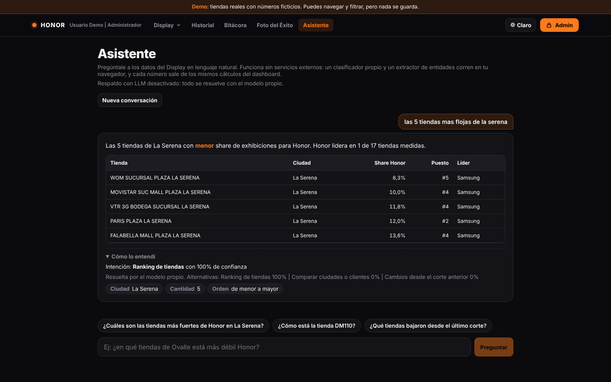

# Dashboard de Área Display | Honor Zona Norte

[](https://github.com/maticodder28/display-honor-demo/actions/workflows/ci.yml)


Trabajo como merchandiser de Honor en la III y IV Región, en un equipo de tres personas que cubre unas 50 tiendas
entre Copiapó, Vallenar, La Serena, Coquimbo y Ovalle. Cada levantamiento de exhibición quedaba en un Excel distinto,
y no había forma rápida de saber dónde estaba débil la marca, si íbamos mejorando o qué se había hecho en cada tienda.
Así que armé esta web. Hoy la usa el equipo para ver el share de Honor frente a la competencia, seguir su evolución,
registrar lo que hacemos en terreno y recibir el checklist semanal que llenan los promotores.

**Demo:** [display-honor-demo.vercel.app](https://display-honor-demo.vercel.app). No pide login. Las tiendas son las
reales de la zona, pero todos los números son inventados (share, cantidades, coberturas, códigos y personas). La
versión que usamos está en un repo privado.


## Qué hace

- **Display:** share de Honor en exhibiciones, muebles (DC y Display Zone) y promotores frente a 9 marcas. Se puede
  filtrar por cobertura, cadena y ciudad, y ver el puesto de Honor, la marca líder y el detalle por tienda.
- **Historial:** cada Excel que se publica queda como un corte con fecha. Ahí se ve la evolución y se pueden comparar
  dos cortes tienda por tienda.
- **Bitácora:** visitas, ventas por ejecutivo, incentivos con su costo, capacitaciones y pendientes, con un ranking
  mensual de ejecutivos y un reporte en Excel.
- **Foto del Éxito:** el checklist semanal de Entel. Cada promotor lo llena desde el celular y se calcula el
  cumplimiento según el cluster de la tienda.
- **Admin:** carga del Excel de levantamiento. Antes de publicar se revisan hojas, marcas, códigos y valores raros.
- **Asistente:** se le pregunta a los datos en lenguaje natural, por ejemplo "¿en qué tiendas de Ovalle está más
  débil Honor?".

| Historial | Bitácora |
|---|---|
|  |  |

| Foto del Éxito | Celular |
|---|---|
|  |  |

## El asistente



Quería que alguien del equipo pudiera preguntar algo sin tener que saber dónde mirar. Lo armé en dos capas.

La primera es un modelo propio que corre en el navegador, sin APIs ni costo. Primero detecta en la pregunta la tienda,
ciudad, cadena, marca o métrica, aguantando errores de tipeo ("ovale", "falabela", "la 279898"). Después un
clasificador de intención decide qué se está preguntando: TF-IDF y regresión logística, entrenado con un script propio
sin librerías de ML. La respuesta sale de las mismas funciones del dashboard, así que no inventa números. Con 75
preguntas escritas a mano, distintas de las de entrenamiento, acierta en el 94,7 %. El detalle está en
[docs/asistente-evaluacion.md](docs/asistente-evaluacion.md).

La segunda es un agente con un LLM en [Groq](https://console.groq.com) para preguntas abiertas, como "¿qué opinas
de nuestro panorama?" o "¿dónde debería enfocar el trabajo esta semana?". El modelo consulta las mismas herramientas
las veces que necesite, razona con los resultados y escribe un análisis. Al final, un verificador revisa que cada
porcentaje de su respuesta aparezca en las consultas y marca los que no. Si Groq falla o se acaba la cuota, responde
el modelo propio. En la versión real del equipo el agente está apagado, porque mandaría datos de Honor a un servicio
externo.

## Cómo está hecho

Next.js 15 con TypeScript, Supabase (PostgreSQL, Auth y Row Level Security) y Vercel en Sao Paulo, en la misma
región que la base de datos. Las decisiones que más me importaron:

- Los permisos viven en Postgres con RLS, no solo en la página. Un promotor solo ve su Foto del Éxito aunque llame a
  la API directo, y nadie puede darse permisos de admin a sí mismo.
- Publicar un Excel es una sola función SQL, así que entra todo o no entra nada.
- Una fila vacía no es lo mismo que un 0. Vacía significa que no se midió y no cuenta; 0 significa que Honor no
  tiene nada en esa tienda. Si los mezclara, las tiendas no visitadas bajarían el share.
- Las prioridades de la Foto del Éxito se guardan semana a semana, y un producto ya usado no se puede borrar, solo
  ocultar. Así, cambiar la lista del mes no altera las semanas pasadas.
- El código está ordenado con Clean Architecture: dominio (reglas puras), casos de uso, infraestructura (Supabase,
  demo, Groq) y presentación. La interfaz nunca habla con la base: escribe con server actions que pasan por un caso de
  uso, y el lint falla si alguien rompe esa regla. La demo no es un `if` repartido por el código, es otra
  implementación de los mismos repositorios. El detalle, con cómo aplico SOLID, está en [CODIGO.md](docs/CODIGO.md).
- Las librerías de Excel se cargan solo cuando se usan. Eso bajó el JavaScript inicial del Historial de 259 a 116 KB.

Para el detalle del código, archivo por archivo, está [docs/CODIGO.md](docs/CODIGO.md).

## Calidad

- 120 tests unitarios con Vitest (reglas del negocio y casos de uso con repositorios falsos) y 31 pruebas de navegador con Playwright, en escritorio y celular.
- Accesibilidad WCAG 2.1 AA revisada con axe en las 6 pantallas y en los dos temas. La primera revisión encontró más
  de 200 elementos con poco contraste y los corregí en las variables de color.
- Lighthouse en la compilación de producción: rendimiento entre 96 y 100, y 100 en accesibilidad, buenas prácticas
  y SEO.
- GitHub Actions corre tipos, lint, tests, compilación y pruebas de navegador en cada push.

## Probarlo

Con Node.js 20 o superior, en modo demo no se necesita ninguna cuenta:

```bash
npm install
cp .env.example .env.local      # deja NEXT_PUBLIC_DEMO=1
npm run dev
```

Para la versión completa con Supabase, login y roles, está la [guía de instalación](docs/INSTALACION.md). El
[manual de uso](docs/MANUAL.md) explica cada pantalla para quien usa la app día a día.

| Comando | Qué hace |
|---|---|
| `npm run dev` | Servidor local en http://localhost:3000 |
| `npm test` | Tests unitarios |
| `npm run test:e2e` | Pruebas de navegador y accesibilidad |
| `npm run typecheck` / `npm run lint` | Tipos y ESLint |
| `npm run build` | Compilación de producción |
| `npm run seed:demo` | Regenera `supabase/seed.sql` con los datos de la demo |
| `npm run asistente:entrenar` | Entrena el clasificador del asistente y regenera su evaluación |

## English summary

A web app I built for Honor's merchandising team in northern Chile, where I work in the field. It replaced scattered
spreadsheets with a dashboard that tracks the brand's in-store display share against 9 competitors across about 50
stores, keeps a history of every survey upload, logs the team's store visits and incentives, and collects a weekly
checklist that promoters fill in from their phones. It also has a natural-language assistant: an intent classifier
and entity extractor I trained from scratch that runs in the browser, plus an optional LLM agent on Groq that answers
open questions by calling the app's data tools and checks every figure it cites. The code follows Clean
Architecture (domain, use cases, infrastructure, presentation), with the dependency rule enforced by ESLint. Next.js 15, TypeScript, Supabase
(PostgreSQL with Row Level Security) and Vercel. This public version runs on demo data.

## Autor

Matías Munizaga Fuentes, Ingeniero en Informática. [LinkedIn](https://www.linkedin.com/in/matias-munizaga-fuentes)
